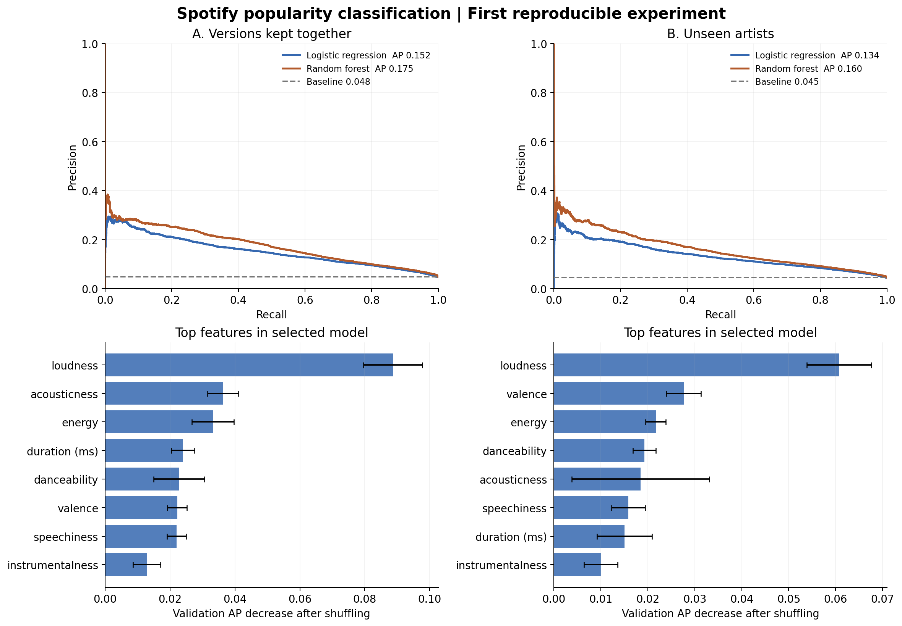
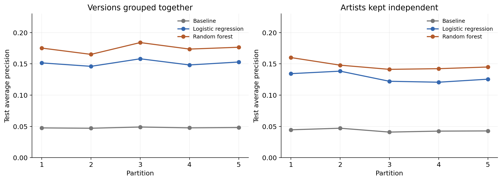

# Spotify Popularity Analysis

Can audio and musical-structure features distinguish high-popularity Spotify tracks, including tracks by artists not seen during training?

This data science project studies **recorded popularity**, not future commercial success. It covers a data audit, leakage-aware model evaluation, feature interpretation, and stability across five data partitions.

## Main findings

- The supplied catalogue contains **586,672 tracks**. **27,844 (4.75%)** have popularity scores of at least 60, the project-defined positive class.
- Models use **13 audio and musical-structure features**. Artist identities, track names, release dates, and explicit-content flags are excluded from model inputs.
- A constant-score baseline, logistic regression, and random forests are compared.
- Across five artist-independent partitions, the fixed random forest achieves mean **average precision (AP) of 0.1473** (sample SD 0.0076; range 0.1412–0.1601), mean precision **17.05%**, and mean recall **33.22%**.
- Audio features contain a useful ranking signal, but false positives and false negatives remain common. Feature importance describes predictive associations, not causation.

See the [English report (PDF)](reports/Spotify_Popularity_Project_Report.pdf) or [editable Word report](reports/Spotify_Popularity_Project_Report.docx).

## Repository contents

| File or folder | Purpose |
| --- | --- |
| `Spotify_01_Data_Audit.ipynb` | Inspect completeness, labels, duplicates, and release dates |
| `Spotify_02_First_Models.ipynb` | Group possible versions, construct partitions, select models, and evaluate held-out data |
| `Spotify_03_Stability_Check.ipynb` | Evaluate four additional partitions and summarize all five |
| `model_results/` | Original experiment settings, aggregate metrics, overlap checks, and chart |
| `stability_results/` | Repeated-partition metrics, settings, checks, and chart |
| `reports/` | Six-page English report in PDF and Word formats |
| `requirements.txt` | Analysis dependencies and JupyterLab |

The notebooks include their recorded outputs. Notebooks 01 and 02 retain Chinese explanations; Notebook 03 and the report are in English.

## Data

Source: [Spotify Dataset 1921–2020, 600k+ Tracks — Yamac Eren Ay](https://www.kaggle.com/datasets/yamaerenay/spotify-dataset-19212020-600k-tracks).

The original dataset is **not included**. Use the original `archive.zip` supplied for this project, containing `tracks.csv`, and place it in the repository root. Alternatively, edit `DATA_PATH` in each notebook. The notebooks also look for `archive.zip` in the current user's Downloads folder.

The exact `tracks.csv` used for the reported experiments has SHA-256:

```text
8a08c199bd93438783e915470ec3ea1142c1267f2da48b7d1315d2b9f5d39cf9
```

A newer download may differ. Notebooks 02 and 03 verify the source hash; if it differs, audit the new data and rerun the study rather than treating the recorded results as applicable. Despite the source title, the supplied catalogue includes release records through 2021 and one record dated 1900. Its collection timestamp is not established.

## Run locally

The model experiments used **Python 3.13.9**. From the repository root on macOS or Linux:

```bash
python3 -m venv .venv
source .venv/bin/activate
python -m pip install -r requirements.txt
python -m jupyterlab
```

On Windows, activate the environment with `.venv\Scripts\Activate.ps1` in PowerShell.

Run every cell in notebooks **01 → 02 → 03**, using a fresh kernel for each notebook. Keep the notebook working directory at the repository root.

Notebook 02 generates the split manifest and fitted models. Notebook 03 requires that generated `model_results/split_manifest.csv.gz` plus the original experiment metadata and scores. **Run Notebook 02 before Notebook 03** on a fresh clone.

Training uses four parallel workers and can consume substantial memory and CPU. Reduce `N_JOBS` in Notebook 02 and `n_jobs=4` in Notebook 03 if needed. No GPU is required. The notebooks write results into `model_results/` and `stability_results/`, replacing matching files.

## Evaluation design

1. Define high popularity as a recorded score **>= 60**. This is an analytical threshold, not an official definition of a hit.
2. Keep heuristically linked versions of the same song in the same partition.
3. Compare version-grouped evaluation with stricter artist-independent evaluation. In the strict setting, artist overlap across train, validation, and test is zero; cross-partition collaborations are excluded.
4. Fit preprocessing only on training data. Select model capacity and classification thresholds using validation data, then evaluate on the held-out test data.
5. Freeze the selected model configurations for four additional partitions. Refit within each partition and select its threshold using that partition's validation set.

AP summarizes precision–recall ranking quality; it is not accuracy or a calibrated probability. Accuracy alone is misleading because about 95% of tracks are negative. Repeated partitions reuse the same catalogue, so their spread is not a confidence interval or independent external replication.

## Generated artifacts and limitations

Large fitted models (`*.joblib`), row-level predictions, and split manifests (`*.csv.gz`) are intentionally omitted from Git and can be regenerated by the notebooks. Included verification JSON files describe the original complete local run; they are not a check that every generated artifact is present in this clone.

The data do not include all drivers of popularity, such as marketing, playlist exposure, or artist influence. Artist-independent filtering also changes the representation of collaborations. No external, prospective, or deployment validation has been completed. Classifier scores are not calibrated hit probabilities.




